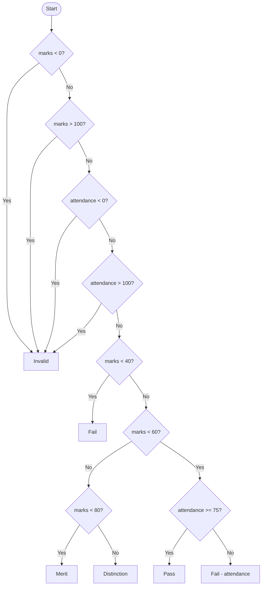

# Lab Sheet 5 - Control Flow Graph and Path Coverage

## Project
TestForge Student Portal

## Method under test
ResultCalculator.calculate(int marks, double attendancePercent)

Source:
src/main/java/com/testforge/service/ResultCalculator.java

## Control flow

The following graph expands both short-circuit OR conditions into their individual checks.

## Cyclomatic complexity

When the two OR expressions are expanded into separate short-circuit checks:
- Decision checks: 8
- Cyclomatic complexity: V(G) = 8 + 1 = 9

If a simplified graph treats each compound OR expression as one decision,
the count is 6 decisions and V(G) = 7. This document uses the expanded graph.

## Existing automated path tests

src/test/java/com/testforge/service/ResultCalculatorPathCoverageTest.java

The nine representative paths and expected outputs are listed in Path_Coverage.csv.

## Conclusion
Path coverage verifies representative routes through the result calculation logic, including invalid inputs, attendance conditions and grade outcomes.